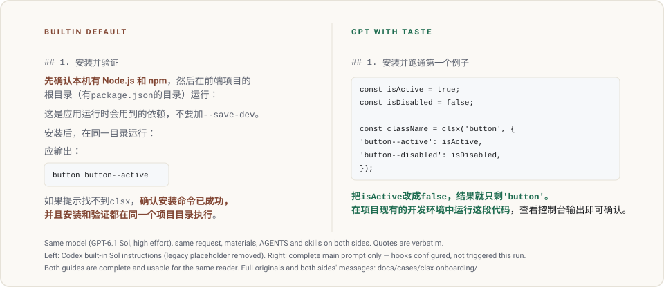

<p align="right">
  <strong>English</strong> · <a href="README.zh-CN.md">简体中文</a>
</p>

<picture>
  <source media="(prefers-color-scheme: dark)" srcset="assets/hero-banner-dark.svg">
  <source media="(prefers-color-scheme: light)" srcset="assets/hero-banner-light.svg">
  
</picture>

<p align="center">
  A drop-in behavioral recipe for Codex: make ordinary decisions, digest complexity, and deliver work with engineering and visual craft.<br>
  Built for the GPT reasoning family, especially GPT-6.1 Sol and GPT-6 Astra. Replies follow the language you write in.
</p>

<p align="center">
  <a href="#install">Install</a> ·
  <a href="#what-changes">What changes</a> ·
  <a href="#featured-case">Featured case</a> ·
  <a href="#how-it-works">How it works</a> ·
  <a href="#research">Research</a>
</p>

---

<a id="install"></a>

## Install

With Node.js 22 or newer installed:

```sh
git clone https://github.com/NB-Corp/gpt-with-taste.git
cd gpt-with-taste
node scripts/install.mjs --hooks
```

We recommend Hooks for multi-turn work in Codex Desktop: reminders arrive with your message, with the child's input, and when main collects a completed result. For a prompt-only installation, run `node scripts/install.mjs` instead. Neither route needs npm packages.

Both routes install into the active `CODEX_HOME` (otherwise `~/.codex`), write the two managed prompt files, and point `model_instructions_file` at the main one. Your model, provider, effort, authentication, permissions, MCP servers, roles, and `AGENTS.md` remain unchanged. To target another home, add `--home` with a quoted absolute path, for example `--home "C:/Users/you/.codex"`.

With `--hooks`, review and trust the three installed definitions in Codex Desktop under **Settings → Hooks**, or in the interactive terminal with `/hooks`. Enable only the events you want. Open a **new Codex session** after installation.

Prefer to delegate? Give your coding assistant this repository and [docs/install-for-ai.md](docs/install-for-ai.md). To recover the managed state, use [docs/recovery.md](docs/recovery.md). The complete installation contract is in [docs/install.md](docs/install.md).

---

<a id="what-changes"></a>

## What changes

GPT with Taste puts judgment into the outcome: choose sensible defaults, preserve supported claims, synthesize useful collaborator results, and finish work with care.

<picture>
  <source media="(prefers-color-scheme: dark)" srcset="assets/comparison-diagram-dark.svg">
  <source media="(prefers-color-scheme: light)" srcset="assets/comparison-diagram-light.svg">
  
</picture>

The recipe combines judgment, continuous execution, collaboration, and engineering and visual craft. [Research](docs/research.md) explains the principles; [the case index](docs/cases.md) keeps the underlying inputs and outputs separate from draft material.

---

<a id="featured-case"></a>

## Featured case · clsx onboarding

**Draft / unverified.** The preferred case is a general documentation task: write a Chinese getting-started guide for people new to the open-source [`lukeed/clsx`](https://github.com/lukeed/clsx) project.

<picture>
  <source media="(prefers-color-scheme: dark)" srcset="assets/case-clsx-onboarding-dark.svg">
  <source media="(prefers-color-scheme: light)" srcset="assets/case-clsx-onboarding-light.svg">
  
</picture>

The archive records the same request, GPT-6.1 Sol at high effort, native Codex 0.162.0-alpha.17.2, the builtin model-catalog instruction source versus the frozen Taste prompt, and Hooks configured but not triggered. It also contains the source snapshot and two generated guide artifacts.

The original full assistant messages are not archived, so the artifacts are not presented as a verified or verbatim model-output comparison. Read the [case record](docs/cases.md#featured-case), or open the [static comparison page](site/index.html), which keeps this status visible and shows the missing-evidence note.

The current verified evidence is the secondary [Button class override comparison](docs/cases.md#verified-evidence), with complete input and outputs. It remains available as a method reference rather than a performance score.

---

<a id="how-it-works"></a>

## How it works

1. **The system prompt sets standing priorities.** It covers judgment, execution, collaboration, and craft. The instructions are English; replies follow your latest language.
2. **Steer refreshes the relevant priorities near each input.** The local plugin sends user reminders to main, scoped reminders to children, and result-consumption reminders to main after a completed wait. A child's paired startup events produce one reminder. [Installation details](docs/install.md#add-optional-per-turn-steering) cover the events and client entry points.

`prompts/sub.md` is included for roles you choose. Main and sub prompts each contain the complete behavior; `--hooks` installs all three reminder routes.

---

<a id="research"></a>

## Research

[docs/research.md](docs/research.md) connects published findings to the recipe and documents the development loop. It distinguishes verified case evidence from the draft clsx candidate instead of treating a file's presence as behavioral proof.

---

<p align="center">
  <a href="LICENSE">MIT License</a> · Community friend link: <a href="https://linux.do/">Linux DO</a>
</p>
