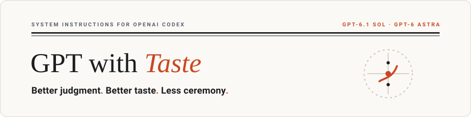
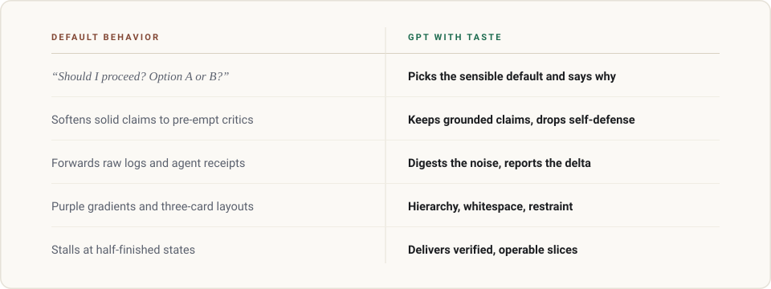
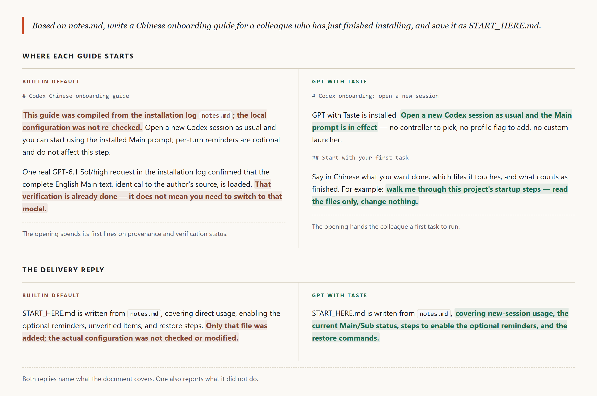

<p align="right">
  <strong>English</strong> · <a href="README.zh-CN.md">简体中文</a>
</p>

<picture>
  <source media="(prefers-color-scheme: dark)" srcset="assets/hero-banner-dark.svg">
  <source media="(prefers-color-scheme: light)" srcset="assets/hero-banner-light.svg">
  
</picture>

<p align="center">
  A drop-in behavioral recipe for Codex: make ordinary decisions, digest complexity, and deliver work with engineering and visual craft.<br>
  Built for the GPT reasoning family, especially GPT-6.1 Sol and GPT-6 Astra. Replies follow the language you write in.
</p>

<p align="center">
  <a href="#install">Install</a> ·
  <a href="#what-changes">What changes</a> ·
  <a href="#featured-case">Comparison</a> ·
  <a href="#how-it-works">How it works</a> ·
  <a href="#research">Research</a>
</p>

---

<a id="install"></a>

## Install

With Node.js 22 or newer installed:

```sh
git clone https://github.com/NB-Corp/gpt-with-taste.git
cd gpt-with-taste
node scripts/install.mjs --hooks
```

We recommend Hooks for multi-turn work in Codex Desktop: reminders arrive with your message, with the child's input, and when main collects a completed result. For a prompt-only installation, run `node scripts/install.mjs` instead. Neither route needs npm packages.

Both routes install into the active `CODEX_HOME` (otherwise `~/.codex`), write the two managed prompt files, and point `model_instructions_file` at the main one. Your model, provider, effort, authentication, permissions, MCP servers, roles, and `AGENTS.md` remain unchanged. To target another home, add `--home` with a quoted absolute path, for example `--home "C:/Users/you/.codex"`.

With `--hooks`, review and trust the three installed definitions in Codex Desktop under **Settings → Hooks**, or in the interactive terminal with `/hooks`. Enable only the events you want. Open a **new Codex session** after installation.

Prefer to delegate? Give your coding assistant this repository and [docs/install-for-ai.md](docs/install-for-ai.md). To recover the managed state, use [docs/recovery.md](docs/recovery.md). The complete installation contract is in [docs/install.md](docs/install.md).

---

<a id="what-changes"></a>

## What changes

GPT with Taste puts judgment into the outcome: choose sensible defaults, preserve supported claims, synthesize useful collaborator results, and finish work with care.

<picture>
  <source media="(prefers-color-scheme: dark)" srcset="assets/comparison-diagram-dark.svg">
  <source media="(prefers-color-scheme: light)" srcset="assets/comparison-diagram-light.svg">
  
</picture>

The recipe combines judgment, continuous execution, collaboration, and engineering and visual craft. Explore the principles in [Research](docs/research.md), or inspect complete runs, task inputs, and side-by-side outputs in the [Case Archive](docs/cases.md) and [Web Comparison](https://nb-corp.github.io/gpt-with-taste/).

---

<a id="featured-case"></a>

## Comparison · From installation logs to a first task

> **Task request**: Use `notes.md` to write a Chinese getting-started guide for a colleague who has just finished installing. Save it as `START_HERE.md`.

The visible improvement is straightforward: get the reader started first, while installation audits and process disclaimers step out of the way.

[](https://nb-corp.github.io/gpt-with-taste/)

Inspect full inputs, generated documents, and run conditions: [Task & run conditions](docs/cases/codex-first-use/input.md) · [Web comparison page](https://nb-corp.github.io/gpt-with-taste/) · [Case index](docs/cases.md).

---

<a id="how-it-works"></a>

## How it works

1. **The system prompt sets standing priorities.** It covers judgment, execution, collaboration, and craft. The instructions are English; replies follow your latest language.
2. **Steer refreshes the relevant priorities near each input.** The local plugin sends user reminders to main, scoped reminders to children, and result-consumption reminders to main after a completed wait. A child's paired startup events produce one reminder. [Installation details](docs/install.md#add-optional-per-turn-steering) cover the events and client entry points.

`prompts/sub.md` is included for roles you choose. Main and sub prompts each contain the complete behavior; `--hooks` installs all three reminder routes.

---

<a id="research"></a>

## Research

[docs/research.md](docs/research.md) details the findings, prompt architecture, and iteration loop behind the recipe: how defensive writing affects the reader's experience, why models need room for ordinary judgment, and how collaborator findings are turned into direct action.

---

<p align="center">
  <a href="LICENSE">MIT License</a> · Community friend link: <a href="https://linux.do/">Linux DO</a>
</p>
