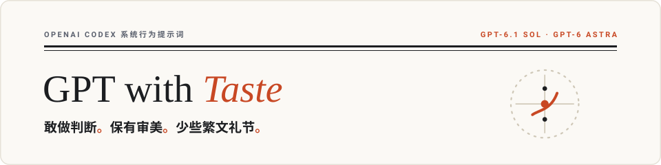
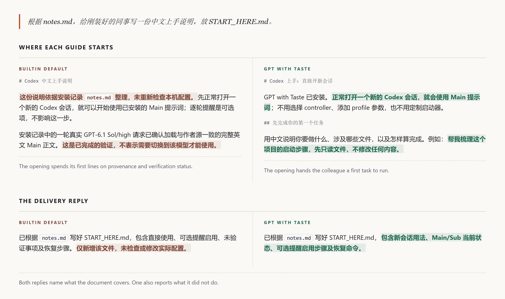

<p align="right">
  <a href="README.md">English</a> · <strong>简体中文</strong>
</p>

<picture>
  <source media="(prefers-color-scheme: dark)" srcset="assets/hero-banner-zh-dark.svg">
  <source media="(prefers-color-scheme: light)" srcset="assets/hero-banner-zh-light.svg">
  
</picture>

<p align="center">
  一套即装即用的 Codex 行为配方：作出常规判断、消化复杂度，并以工程与视觉审美交付工作。<br>
  面向 GPT 推理家族，尤其是 GPT-6.1 Sol 与 GPT-6 Astra；回复跟随你使用的语言。<br>
  <em>Better judgment. Better taste. Less ceremony.</em>
</p>

<p align="center">
  <a href="#install">安装</a> ·
  <a href="#what-changes">改变什么</a> ·
  <a href="#featured-case">对照示例</a> ·
  <a href="#how-it-works">工作机制</a> ·
  <a href="#research">研究依据</a>
</p>

---

<a id="install"></a>

## 安装

需要 Node.js **22 或更高版本**。默认只把提示词文件复制到当前 `CODEX_HOME`（未设置时为 `~/.codex`）。**不会修改** `config.toml`、`model_instructions_file` 或 `developer_instructions`。

```sh
git clone https://github.com/ItosEO/gpt-with-taste.git
cd gpt-with-taste
node scripts/install.mjs
```

需要事件提醒时，执行 `node scripts/install.mjs --hooks`。该模式也**保留 Codex 原生基础指令**。在 Codex Desktop 的 **设置 → 钩子**（或终端 `/hooks`）中审核并信任三个 Hook，然后新开一个会话。

需要 Taste 的长期行为规则时，由用户手动向 `~/.codex/config.toml` 顶层的 `developer_instructions` 添加选定规则；如该键已经存在，应编辑原值，不要写第二个同名键。例如：

```toml
developer_instructions = """
Make ordinary decisions independently within the user's authorization.
Prefer maintainable code, meaningful checks and clear, direct explanations.
Preserve material uncertainty, evidence and important limitations.
"""
```

如确实需要**完整替换**原生基础指令，显式执行 `node scripts/install.mjs --override-base`（可以同时使用 `--hooks`）。已有旧版覆盖安装若要改用原生模式，应先执行 `--restore`，然后重新安装且不带 `--override-base`。

可用 `--dry-run` 预览、`--check` 检查、`--restore` 恢复。保留克隆目录及其私有的 `.gpt-with-taste/install-receipt.json` 恢复记录。用户已有的权限、MCP、角色和 `AGENTS.md` 不受影响。

详细说明：[安装](docs/install.md)、[恢复](docs/recovery.md)、[提示词分层](docs/prompt-map.md)。

---

<a id="what-changes"></a>

## 改变什么

GPT with Taste 把判断力用在结果上：作出合理选择、保留有据主张、消化有用的协作结果，并认真完成工作。

<picture>
  <source media="(prefers-color-scheme: dark)" srcset="assets/comparison-diagram-zh-dark.svg">
  <source media="(prefers-color-scheme: light)" srcset="assets/comparison-diagram-zh-light.svg">
  
</picture>

这套配方结合了判断、连续执行、协作、工程与视觉审美。在[研究依据](docs/research.md)中了解设计原则；在[案例索引](docs/cases.md)与[网页版对比展示](https://nb-corp.github.io/gpt-with-taste/)中查阅完整任务输入与实际对照输出。

---

<a id="featured-case"></a>

## 对照示例 · 从安装记录到上手说明

> **同题请求**：根据 notes.md，给刚装好的同事写一份中文上手说明，放 START_HERE.md。

可见的改善很直接：先让读者开始，安装证明与过程自证退出主线。

[](https://nb-corp.github.io/gpt-with-taste/)

查阅完整输入、生成文档与运行条件：[同题任务与运行记录](docs/cases/codex-first-use/input.md) · [网页版对比展示](https://nb-corp.github.io/gpt-with-taste/) · [案例索引](docs/cases.md)。

---

<a id="how-it-works"></a>

## 工作机制

1. **完整主提示词改为可选。** 默认保留 Codex 原生指令；用户可手动追加 Developer Instructions，或显式使用 `--override-base` 完整替换。
2. **Steer 在输入附近重新强调对应行为。** 本地插件把用户提醒交给主控，把范围内执行提醒交给子 Agent，并在主控取回完成回执后送入成果消费提醒。子 Agent 配对的启动事件只注入一份提醒。具体事件和客户端入口见[安装说明](docs/install.md#add-optional-per-turn-steering)。

`prompts/sub.md` 是供指定角色使用的精简只读规则。Hooks 只提供任务提醒，不决定子代理权限；`--hooks` 安装三条提醒路线，但不修改模型基础指令。

---

<a id="research"></a>

## 研究依据

[docs/research.md](docs/research.md) 梳理了配方背后的研究发现、提示词架构与迭代方法：防御性写作如何影响阅读体验、为何给模型保留常规判断空间，以及如何将协作与审查反馈直接转化为行动。

---

<p align="center">
  <a href="LICENSE">MIT 许可证</a> · 社区友链：<a href="https://linux.do/">Linux DO</a>
</p>
