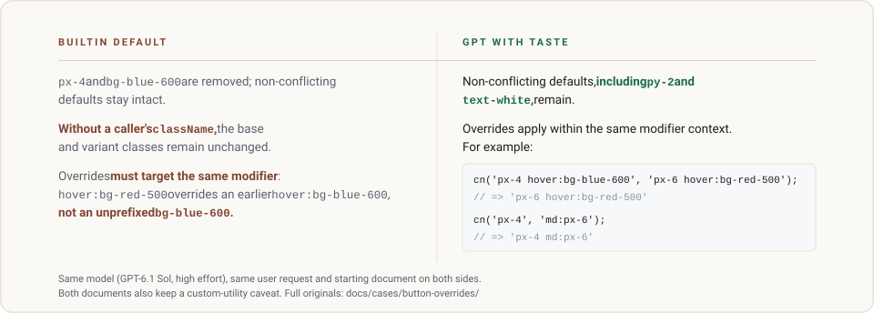

<p align="right">
  <a href="README.md">English</a> · <strong>简体中文</strong>
</p>

<picture>
  <source media="(prefers-color-scheme: dark)" srcset="assets/hero-banner-zh-dark.svg">
  <source media="(prefers-color-scheme: light)" srcset="assets/hero-banner-zh-light.svg">
  
</picture>

<p align="center">
  一套即装即用的行为配方，让 Codex 不再像战战兢兢的外包。<br>
  它敢做常规判断、替你消化复杂度，并以工程与视觉审美交付工作。<br>
  面向整个 GPT 推理家族——尤其 GPT-6.1 Sol 与 GPT-6 Astra；回复始终跟随你使用的语言。
</p>

<p align="center">
  <a href="#安装">安装</a> ·
  <a href="#改变什么">改变什么</a> ·
  <a href="#真实对照">真实对照</a> ·
  <a href="#工作机制">工作机制</a> ·
  <a href="#研究依据">研究依据</a>
</p>

---

## 安装

安装 Node.js 22 或更高版本后，运行：

```sh
git clone https://github.com/NB-Corp/gpt-with-taste.git
cd gpt-with-taste
node scripts/install.mjs --hooks
```

推荐在 Codex 客户端会分发对应事件时为多轮任务安装 Hooks：它会在当前轮附近重新强调关键行为。已测试的 `exec resume` 流程没有分发这些可选事件，使用前先确认实际客户端投递。偏好只用系统提示词，就把安装命令换成 `node scripts/install.mjs`，同样是完整路线。两种安装都不依赖 npm 包。

两条路线都装入当前生效的 `CODEX_HOME`（未设置时为 `~/.codex`），写入两个受管提示词文件，并把顶层 `model_instructions_file` 指向 main。你的模型、provider、effort、认证、权限、MCP、角色与 `AGENTS.md` 全部原样保留。要装到别处，追加 `--home` 与带引号的绝对路径，如 `--home "C:/Users/you/.codex"`。

使用 `--hooks` 时，在 Codex Desktop 的**设置 → 钩子**中信任并开启这三个定义；也可以在交互终端输入 `/hooks`。启用前审查 `UserPromptSubmit`、`SubagentStart` 和 `PostToolUse`。

装完**新开一个 Codex 会话**，即可使用已安装的提示词。

想省事，就把本仓库连同 [docs/install-for-ai.md](docs/install-for-ai.md) 直接交给你的编程助手代办。要恢复原状，[docs/recovery.md](docs/recovery.md) 一条命令只回退受管状态。完整安装说明见 [docs/install.md](docs/install.md)。

---

## 改变什么

GPT with Taste 把判断力用在你的结果上：作出合理选择、保留有据主张、消化协作结果、完成有审美的工作。它针对这些日常习惯作出调整：

<picture>
  <source media="(prefers-color-scheme: dark)" srcset="assets/comparison-diagram-zh-dark.svg">
  <source media="(prefers-color-scheme: light)" srcset="assets/comparison-diagram-zh-light.svg">
  
</picture>

判断、连续执行、协作、工程与视觉审美都是这套配方的组成部分。塑造这些规则的任务切片见 [docs/research.md](docs/research.md#development-cases)，输出差异就在下方的对照里。

---

## 真实对照

两个全新的 Codex 会话收到同一份请求——更新一份组件文档，让调用方可以安全覆盖 Tailwind 工具类。左侧是内置提示词，右侧是 GPT with Taste；下图是两侧文档收尾时刻的原文摘录：

<picture>
  <source media="(prefers-color-scheme: dark)" srcset="assets/case-button-overrides-dark.svg">
  <source media="(prefers-color-scheme: light)" srcset="assets/case-button-overrides-light.svg">
  
</picture>

两份文档都完成了任务，也都保留了对自定义工具类的提醒；差别在判断力的去向：内置答案告诉读者必须满足什么条件，Taste 答案直接交出可套用的写法。摘录逐字保留英文原文，高亮只做标记。完整对照与原始文件：[docs/cases.md](docs/cases.md) · [site/index.html](site/index.html)（建议本地克隆后打开）。

---

## 工作机制

1. **系统提示词承担主要工作。** 它为判断、执行、协作与审美建立长期指令。提示词本体为英文；实际回复跟随用户最新使用的语言。
2. **Steer 在客户端分发 Hook 事件时重新强调关键行为。** 本地脚本将一条聚焦的提醒作为 developer context 返回：作出普通选择、消化复杂度、选择性路由、删掉无用小字。已测试的 `exec resume` 流程没有分发这些可选事件，使用前先在你的 Codex 客户端确认实际投递。

`prompts/sub.md` 留给你指定的角色使用。安装器接入用户轮次的 Steer；`sub-steer.md` 与 `agent-steer.md` 是分别面向子任务输入、主控消费协作回执的作者源，供独立事件集成使用。main 与 sub 提示词各自包含完整行为。

---

## 研究依据

[docs/research.md](docs/research.md) 将公开研究的发现与配方设计联系起来。其中一项对照实验很说明问题：面向审稿人改写的文本在 AI 评审那里得分更高，人类读者却觉得更难读。塑造这些规则的开发案例也收录在同一文件中。

---

<p align="center">
  <a href="LICENSE">MIT 许可证</a> · 社区友链：<a href="https://linux.do/">Linux DO</a>
</p>
